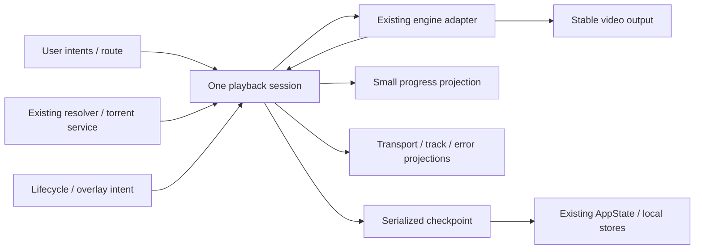

# Station 09 — Architecture and engine options draft

## Status

- Status: COMPLETE — Station 09 planning/approval checkpoint; Gate B APPROVED WITH CONDITIONS for Option A, retain media_kit and decouple structure. Interface contracts remain DRAFT for Station 10. No implementation started.
- Verification status: STATIC-ONLY. Proposed behavior is unimplemented; runtime acceptance NOT-VERIFIED.
- Date: 2026-10-21, Asia/Riyadh. Checklist: 9/9 planning/approval tasks complete; current conditions recorded in `GATE_B_REVIEW.md`.
- Gate A accepted with explicit user baseline waiver; verbatim decision in `GATE_A_REVIEW.md`.
- **Reduced confidence:** no valid legacy baseline exists. Every BEFORE value stays NOT MEASURED. All performance conclusions remain STRONGLY INFERRED or UNKNOWN. `BASELINE.md` stays INCOMPLETE.
- Latest user instruction authorizes only the six Gate B documentation/plan files, after displaying staged paths, then STOP after commit. No push/tag. Session/progress/rendering/recovery/persistence interface contracts remain DRAFT for finalization in Station 10, which requires explicit user go-ahead.

## Objective / scope / prerequisites / inputs

Present an engine choice and migration design grounded in Station 08, preserving existing streaming, tracks, history, linked services, snapshots and platform identity.

**Performance benefit is UNKNOWN because no valid before/after measurement exists. The purpose of the proposed change is structural decoupling only.** STRONGLY INFERRED design labels identify candidate structural mitigations, not demonstrated speed/smoothness/decoder-drop improvements. This statement applies to all engine options; Gate B approval would not upgrade performance evidence.

Read completely from disk: root `NOVA_PLAYER_PROMPT_V2_1.md` (Section 0 authoritative), `00_MASTER_PLAN.md`, `GATE_A_REVIEW.md`, `08_STATION.md`, `BASELINE.md`. Also read AGENTS, Station 07, license/ownership/09 files, current engine and targeted preferences/segments/page/persistence/package/native metadata. Specification copies/backups remain untouched.

Entry Git: root `C:/Users/hosea/projects/app/Nova`, branch `feature/player-reengineering`, HEAD `d19224bc3a59dbfe9db1c43126842159820ff33f`. Production LKG `c9257c0ea6b74b2b4fd180d5ca0f3e08da8617b5` exists, is an ancestor of HEAD and matches `pre-player-reengineering-baseline`. Initial index empty; 32 pre-existing status entries, none a dirty tracked player file. Existing settings/Android Gradle/docs/removed assets/skills/agent/spec changes are excluded. Pre-existing diagnostic code is not a new validated LKG.

No production, instrumentation, dependency, native, signing, CI or generated-localization edits; no build, install or device command. Gate B approves engine/structural direction and the scoped documentation commit only. Station 10 execution still needs explicit user go-ahead. Personal use only; native-library license classification remains unclear with retained verification plan and mandatory reopening before any planned distribution.

## Tasks

- [x] Compare engines using static/cross-project evidence and explicit baseline waiver.
- [x] Draft session/controller/state/event/rebuild boundaries and resource ownership.
- [x] Draft renderer/control separation and phone/tablet/RTL constraints.
- [x] Draft resume/completion, segments, episode/source/recovery contracts.
- [x] Draft subtitle/audio/speed and lifecycle/disposal contracts.
- [x] Review dependencies/licenses and plan continued legacy selection.
- [x] Record PROPOSED ADRs and map RC1–RC8 to design choices.
- [x] Prepare Gate B draft with reduced confidence, risks and decisions.
- [x] Obtain Gate B approval for Option A and structural direction with conditions; record current decision in `GATE_B_REVIEW.md`. Interface contracts remain DRAFT; commit scoped docs only after displaying staged paths, then STOP awaiting explicit Station 10 go-ahead.

## Evidence required / ledger

VERIFIED below refers only to source/configuration facts. This design is STATIC-ONLY. Structural suitability may be STRONGLY INFERRED; performance benefit is UNKNOWN for all options, with no before/after measurement. No engine is benchmarked.

| ID | Source | Supported fact / limit |
|---|---|---|
| S1 | `08_STATION.md` E1–E7, RC1–RC8 | Accepted bounded diagnosis. Source coupling/recovery/handoff risks; performance contribution STRONGLY INFERRED or UNKNOWN. |
| S2 | `pubspec.yaml`; `pubspec.lock:448–479` | VERIFIED locked media_kit 1.2.6, media_kit_video 2.0.1, Android libs 1.3.8, iOS libs 1.1.4. video_player absent from lock. |
| S3 | `lib/features/player/engine/playback_engine.dart:19–139,242–267,353–410,439–548` | VERIFIED facade, concrete media_kit track/surface coupling, controller readiness wait, paused open then seek/play, track/rate/delay APIs, common notifier, asynchronous disposal. Duration-known is not first rendered frame. |
| S4 | Current `video_player_page.dart` ranges in RC1–RC7 | VERIFIED page owns source/torrent/UI/lifecycle/progress. Widget rebuild is not evidence of decoder recreation. |
| S5 | `playback_preferences.dart`; `segments/playback_segments.dart`; `lib/core/state/app_state.dart:1136–1185` | VERIFIED existing resume/track intent, nullable validated segment times, history identity, last-two-minute Continue Watching/snapshot rules and sync path. Runtime behavior NOT-VERIFIED. |
| S6 | `07_STATION.md`; exact reference snapshots in `LICENSE_NOTES.md` | Historical STATIC-ONLY reference findings. Jellyfin iOS is Expo wrapper; Swiftfin has distinct AVPlayer/MPV/VLC paths. No mobile benchmark from desktop MPV config. |
| S7 | Resolved Pub cache LICENSE/native selectors; license addendum | VERIFIED full LICENSE reads; Section 0.8 wrapper classification permissive (MIT) for media_kit 1.2.6, media_kit_video 2.0.1 and Android/iOS libs wrappers 1.3.8/1.1.4. Android selector v1.1.7 default ABI jars; iOS Makefile v0.6.0 video-default frameworks. Exact native artifact classification unclear; complete license inventory UNKNOWN / NOT-VERIFIED. Exact paths in `LICENSE_NOTES.md`. |
| S8 | Primary upstream docs linked below, read 2026-10-21 | VERIFIED documented APIs/platform declarations; no exact-version NOVA build or runtime result. |

Primary sources for alternatives: [video_player package](https://pub.dev/packages/video_player), [controller API](https://pub.dev/documentation/video_player/latest/video_player/VideoPlayerController-class.html), [BSD license](https://pub.dev/packages/video_player/license), [Media3 formats](https://developer.android.com/media/media3/exoplayer/supported-formats), [Media3 Apache license](https://raw.githubusercontent.com/androidx/media/release/LICENSE). License context: [mpv Copyright](https://raw.githubusercontent.com/mpv-player/mpv/master/Copyright), [Darwin variants](https://raw.githubusercontent.com/media-kit/libmpv-darwin-build/main/README.md). Upstream pages inform options; local cache/lock identifies NOVA's installed packages. Android-build README fetch failed; no artifact license conclusion substituted.

## Findings — engine options

| Option | Choice / rationale | Cost and evidence labels |
|---|---|---|
| A — retain locked media_kit/libmpv; restructure Dart state/ownership | **RECOMMENDED, pending approval.** Address RC1/RC3/RC4/RC7 with existing capabilities/renderer, no dependency addition. | Existing integration VERIFIED / STATIC-ONLY. Lower migration scope STRONGLY INFERRED; playback benefit UNKNOWN. Existing native license risk remains. |
| B — video_player / ExoPlayer Android / AVPlayer iOS | Credible alternative if later evidence identifies engine limitation or distribution needs another stack. | Current API supports audio-track discovery/selection with availability checks; old comments saying it can never select audio are not a valid current comparison. Subtitle/delay/snapshot/format parity unresolved. New dependency gate required. Performance gain UNKNOWN. |
| C — custom Media3 + AVPlayer bridges | Consider only if an essential capability cannot be exposed through an approved plugin. | Two native adapters/render/event pipelines to maintain; iOS cannot compile locally. Higher ownership risk STRONGLY INFERRED. No exact dependency proposal; gain UNKNOWN. |
| D — dual backend / automatic fallback | Defer. Keep extension seam without a second engine implementation. | Combined feature/lifecycle/diagnostics matrix and fallback policy required. References do not prove need. Gain UNKNOWN; new engine/dependency approval required. |

### Candidate addressed by each engine option

All rows are **STATIC-ONLY design assessments**, not implemented fixes. RC1 = rebuild coupling, RC3 = recovery classification, RC4 = source continuity; evidence is `08_STATION.md` RC1/RC3/RC4 and Station 09 S3/S4. STRONGLY INFERRED below describes structural suitability only. **Performance benefit is UNKNOWN for every option.**

| Option | Rebuild coupling — RC1 | Recovery — RC3 | Source continuity — RC4 |
|---|---|---|---|
| A — retain media_kit + decouple host | Scoped progress projections and a stable Video boundary directly target the shared-notifier/page build path: **STRONGLY INFERRED** structural mitigation. | Session-owned failure classification and bounded retries target the ambiguous watchdog: **STRONGLY INFERRED** structural mitigation. | Explicit same-episode position/play/track handoff targets omitted route arguments: **STRONGLY INFERRED** structural mitigation. |
| B — video_player replacement | Replacement alone does not address the Flutter listener boundary; the same host decoupling is required: **STRONGLY INFERRED** need for structural work; engine-only remedy **UNKNOWN**. | Requires the same host classification/retry policy; changed backend APIs do not establish better recovery: engine-specific remedy **UNKNOWN**. | Requires explicit continuity snapshot/rematch/restore just as A; replacing the controller does not supply omitted state: **STRONGLY INFERRED** need for handoff; engine-only remedy **UNKNOWN**. |
| C — custom native bridges | A deliberately scoped Flutter event bridge could target coupling: **STRONGLY INFERRED** structural suitability; no bridge implemented. | Typed native failure reporting is a possible design path; completeness and advantage over the current adapter are **UNKNOWN**, with no prototype/evidence of an engine defect. | A shared session must explicitly carry identity/position/play/track intent across native opens: **STRONGLY INFERRED** structural requirement; automatic continuity from native replacement **UNKNOWN**. |
| D — dual backend / fallback | Adding a second engine does not address the common Flutter build path; shared host decoupling still required: **STRONGLY INFERRED**; engine-only remedy **UNKNOWN**. | Targets only a confirmed backend-specific failure class; whether such a class explains NOVA's RC3 symptoms or needs another engine is **UNKNOWN**. Classification and bounded retries remain necessary. | Backend changes add another handoff requiring the same continuity contract: **STRONGLY INFERRED** structural requirement; automatic continuity from fallback **UNKNOWN**. |

An engine substitution alone is not an evidence-backed remedy for these host-level candidates. A is recommended for structural decoupling with the existing dependency stack; no option is selected on a measured performance advantage.

All criteria below are STATIC-ONLY source/document assessments. NOVA runtime support for every platform/codec is NOT-VERIFIED.

| Criterion | A — existing libmpv | B — video_player | C / D implications |
|---|---|---|---|
| Android / iOS | Locked platform packages/adapter present; no current build. | Documented ExoPlayer / AVPlayer. Pin candidate release and platform minima before adoption. | Separate native/dual paths need platform parity. |
| Hardware decoding | Android requests mediacodec; other platform policy delegated to plugin. Active decoder UNKNOWN. | Native selection; actual hardware path UNKNOWN. | Native API access proves no gain. |
| H.264 / HEVC | libmpv path and plugin codec allow-list; source/profile/device result UNKNOWN. | Depends on platform decoder and container; exact target verification needed. | Real sources required per backend. |
| AV1 / VP9 | Listed Android plugin codecs are not hardware guarantees; runtime UNKNOWN. | OS/device/backend dependent; parity UNKNOWN. | No silent software fallback to satisfy a matrix row. |
| HLS / direct HTTP / local torrent | URL/headers open path exists; HLS/range/reconnect outcomes NOT-VERIFIED. | URL/headers documented; real auth/range/source parity NOT-VERIFIED. | Preserve resolver, headers/file hints and loopback ownership. |
| Embedded / external subtitles | Track/URI APIs and Flutter text overlay; complex ASS/bitmap fidelity UNKNOWN. | Caption API documented; full embedded/ASS/bitmap/offset parity unestablished. | No new parser/renderer without evidence. |
| Multiple audio / speed / seek | APIs present; runtime quality UNKNOWN. | Current API documents track capability query/selection, rate and seek. Platform parity needs checking. | Methods alone do not prove acceptance. |
| HDR / Dolby Vision | Output color/tonemapping/profile/runtime UNKNOWN. | Platform HDR support does not prove Flutter output correctness; Dolby Vision UNKNOWN. | Require target-device evidence. |
| Renderer | Keep VideoController/Video; plugin has Android Surface/native texture machinery; active output unmeasured. | Published view-type options; no evidence output replacement is faster. | Renderer replacement requires rationale and approval. |
| Lifecycle / control / debugging | Existing facade/property access; narrow events and async ownership needed. | Controller APIs documented; NOVA-specific gaps need audit. | More native control increases ownership; dual paths need normalized diagnostics. |
| Maturity / maintenance / upstream health | Already integrated at locked versions; future support/security response UNKNOWN. | flutter.dev package and published docs; responsiveness/compatibility not guaranteed. | Custom maintenance commitment unresolved. |
| Binary size / performance | Deltas NOT MEASURED; same stack retained. | No estimated MB savings; include retained legacy stack in future comparison. | Dual size likely higher (STRONGLY INFERRED), amount UNKNOWN. |
| Migration / long-term risk | Smallest dependency change; concrete track coupling/native risks retained. | Feature regression and lifecycle work; not a proven drop-in replacement. | C has custom ownership; D combined test burden. |

No engine defect or measured replacement benefit demonstrated. Initially retain hwdec/cache settings; classified recovery and measurements must precede tuning. No desktop cache transplantation or global hardware-disable proposal.

## Draft architecture — recommended A

PROPOSED / STATIC-ONLY. Names describe responsibilities; do not create a class/file for every row. Reuse Dart streams/listenables and existing provider, preferences, segments and shared widgets.

| Boundary / proposed location | Ownership | Exclusions |
|---|---|---|
| Existing `engine/playback_engine.dart` | One Player/VideoController, backend subscriptions, normalized state/capabilities, commands and awaitable close. Evolve existing facade only where needed. | Navigation, AppState sync, dialogs/retry policy. |
| Proposed `session/playback_session.dart` | Route-owned session, command ordering, media/source generation, recovery/lifecycle, one terminal close Future. | Second player or independent state controller duplicating truth. |
| Proposed `session/playback_state.dart` if useful | Small transport/error, progress, track and source projections; precise position stays internal. | Duplicate mutable engine state across controllers. |
| Existing `video_player_page.dart` | Thin composition, compatibility entry arguments/callbacks and user intents. | Raw native mutations, independent watchdogs after migration. |
| Existing video/subtitle/control widgets | Stable Video child bound to adapter identity; explicit fit/geometry updates only. Separate subtitle line/style listeners and overlays. | Position/buffer/countdown/panel-driven surface listener. |
| Session handoff + current resolver/torrent services | One resolving/opening transaction, generation guards, torrent acquisition/release. | Global source rewrite, overlapping engine opens. |
| Reused preferences/segments and small feature policies | Resume/track intent/completion/segment/next decisions; pure helpers where useful. | Native resources, invented markers, persisted-format migration. |
| Proposed `session/playback_checkpoint.dart` | Serialized/coalesced immutable checkpoints delegated to AppState/local stores. | Replacement sync/database or remote frame storage. |
| Existing diagnostics helper, later revised | Session-bounded sanitized debug/profile counters/timings/decoder evidence. | Production telemetry, credentials/stream URLs/hashes, release overhead. |

### State frequency / surface contract

- Keep precise backend position at event cadence for seeks/segment/completion decisions. Evaluate segments internally and publish only changed active state. Next-episode state changes on transitions; visible countdown at most once/second.
- Progress projection equality-filters/coalesces latest at at most 10 position-driven UI emissions/second (proposed 100 ms window, Section 51A). Seek/duration reset updates within this cadence; command/error feedback separate. Final saves read exact current position, never sampled UI state.
- Transport/tracks/errors publish changes only. Buffered amount belongs to progress; buffering boolean to transport. Subtitles update changed lines/style/track generation without a 10 Hz timing cap; preserve Arabic shaping/timing.
- Controls/settings/tracks/speed/countdown/rotation retain Video/controller identity. Stable key alone is insufficient: listen/build boundaries exclude Video from position/buffer notifications. Rotation geometry/native output resizing is allowed; no controller recreation proposed. RepaintBoundary is optional after profiling, not a decoder fix.
- Gestures/HUDs local; sort episode neighbors on catalog input change (RC2). Reuse NOVA layout/theme/typography/logical direction, safe areas and text scaling. Later widget coverage: LTR/RTL, themes, phone landscape/tablet sizes; hardware performance separate. No Station 10 visual redesign.

### Command / lifecycle contract

1. States: idle → resolving → opening → prepared → playing/paused; buffering is a transport flag. Seek/switch guarded; typed failure; closing → closed terminal. Prepared/duration-known differs from observed first frame; first frame stays UNKNOWN without a real output signal.
2. One command lane orders open/seek/track/rate/play intent. Each captures generation. Source change/exit invalidates old work, cancels cancellable tasks, awaits native work and ignores stale completion. Acquired resources close once; stale commands cannot act on newer media.
3. Rotation/panel opening does not create a session. Coalesce inactive/background events into one pause/checkpoint. Preserve pause-on-background behavior, no new background audio or automatic foreground play; retain user pause intent.
4. Settings initially retain pause-while-open: capture play intent + generation; resume only if same session/source, no later user/system pause/error and this panel owns the pause. Continuous-play settings is a separate UX option.
5. Widget dispose cannot await: invalidate callbacks/unsubscribe immediately and initiate idempotent close Future. Explicit exit/handoff awaits close before competing native ownership. A hung close fails safely and reports error, never starts a second player. Torrent release follows engine relinquishment; final cleanup runs even if checkpoint fails.

### Source continuity / recovery contract

- Same title AND same episode: snapshot exact position/duration/play intent/speed/manual tracks/subtitle-off/delays; pause, checkpoint, resolve, open once paused, rematch tracks, seek valid target once, restore intended play. Existing open always plays: future adapter must expose paused-open intent; do not assume it exists.
- Track IDs are source-local. Rematch language/role/title, retain explicit off; unavailable selection falls back through existing preferences and exposes actual state. Revalidate external subtitle URLs; no new persisted schema/logged locators.
- New episode/title checkpoints old identity then resets position/segments/countdown/dismissal/track IDs, applying new episode's resume and intended preference/speed policy. Never carry previous episode position.
- Cancelled resolve retains paused old source only while still owned/valid; explicit subsequent play restores it. Once replaced, failed source offers retry/source selection using captured continuity; old source cannot magically roll back without reopen. Non-seekable live source reports unsupported seek/resume.
- Categories: HTTP/auth/source, network/buffering, decode/format, output/lifecycle, subtitle/track/seek, cancelled, unknown. Sanitize diagnostics; zero position + buffering cannot classify a decoder failure. No source/software fallback for every transient stall.
- Proposed retry budget: at most one retry of the same classified recoverable operation per source generation, then explicit retry/source choice. Manual retry starts an explicit new attempt. Decoder-mode recreation, if later necessary, needs evidence and Gate B amendment/conditional approval. No double-open/infinite retry.

### Persistence / resume / feature contract

- Preserve AppState history/sync APIs, item/video/season/episode identity, enabled-provider behavior, keys/callbacks/noor compatibility identifiers. Compressed device-only resume frames stay separate with existing retention.
- Initially keep configured five-second periodic progress policy (not measured I/O cadence). Coalesce latest periodic snapshot while saving; force exact final pause/source/exit checkpoint. Freeze identity before await; serialize so older saves cannot overwrite newer. Surface sanitized errors through existing behavior; no new database/queue.
- Reuse resume prompt/start-over/near-end semantics first. Current Continue Watching/snapshot removal uses last 120000 ms; that is not automatically a next-episode trigger. Centralize equivalent predicates with characterization tests before changing thresholds. Any short-content/storage/sync/completion semantic change triggers data conditional gate.
- Keep writes blocked during unresolved resume choice. Stale/early/near-end resume policy needs Station 13 review; no new expiry or history reinterpretation now.
- Keep validated nullable segment data. Later in-memory extension supports recap/intro/opening/outro/credits with provenance/confidence. Unknown timing hides action. Proposed overlap: containing valid segment with latest start, then earliest end, then stable type order. Seek/source change reevaluates immediately; no stored-format migration.
- Next episode uses real metadata and agreed completion rules; one trigger per content generation, cancel/play-now, suspend countdown during settings/source/resume/error decisions, reset on seek away/episode change. Invalid duration/missing episode/source blocks auto-advance; preserve existing cast action where supported.
- Engine remains subtitle timing/decoding authority, existing Flutter overlay styles it. No second parser/libass-renderer switch before evidence. Future tests cover Arabic/English, embedded/external, delays, fonts/style and resubscription; ASS/bitmap fidelity UNKNOWN.
- Overlay priority proposal: terminal error/source resolution → resume → active settings/source picker → next episode → controls/skip → HUDs. Error dismisses/replaces blocking panel rather than appearing underneath; settings suppress transport gestures, sliders/buttons consume gestures; passive subtitles independent.

### Platform boundaries

| Area | Proposed disposition | Verification |
|---|---|---|
| Android phone | Existing plugin/hwdec/cache first; later inspect actual decoder, focus, interruption, output lifecycle on physical device. | STATIC-ONLY design; runtime NOT-VERIFIED |
| Android tablet | Same session; adaptive widget tests later, physical tablet needed for performance. | STATIC-ONLY design; runtime NOT-VERIFIED |
| iPhone/iPad | Retain media_kit native path; do not call it AVPlayer. Deployment target 13.0 is configuration, not build proof. Podfile/Codemagic config absent. Station 18 owns later investigation. | STATIC-ONLY configuration; build/runtime NOT-VERIFIED |
| Background audio / remote commands | No new behavior; preserve pause policy. Revisit with audio-session/background-mode review. | STATIC-ONLY proposal |
| AirPlay / PiP | New implementation out of initial scope; preserve any discovered existing entry point. No support claim. | NOT-VERIFIED |

Station 18 later owns unsigned Codemagic compile config, iOS checklist and native-change ledger. No native/CI files now. CI may establish BUILD-VERIFIED only; user on-device evidence required for VERIFIED-ON-DEVICE.

## Decisions / migration strategy

ADR-P001 engine/direction is ACCEPTED by the user at Gate B. Detailed session/progress/rendering/recovery/persistence contracts and other ADRs remain DRAFT for Station 10; migration steps below are future proposals, not execution authorization.

1. After explicit architecture/execution approval, characterize current preferences/history/source behavior and introduce a nonpersistent debug/runtime legacy selector before rerouting. Current legacy page remains intact; a two-implementation selector does NOT yet exist. Keep legacy default until new evidence warrants opt-in; never run both engines.
2. Station 10: smallest engine/session/state/surface extraction, ordered close, classified recovery and session-bounded debug/profile observability. No visual redesign, dependency upgrade, decoder/cache experiment or data migration. Measure after meaningful changes in authorized runtime scope.
3. Gate C user device acceptance, then Stations 11–16 incremental controls/tracks/resume/segments/next/UI migration; keep independent legacy route.
4. Stations 17–19: physical Android, static/CI iOS and long playback. Missing metrics remain NOT MEASURED; Gate A waiver does not waive later acceptance gates.
5. Legacy removal only after Gate E approval, separate commit and pre-legacy-removal tag. Unmet/unmeasured targets keep legacy selectable. No selector/removal implemented now.

## Performance evidence / future acceptance

Zero official runs; no new metrics. Every legacy BEFORE and current AFTER is NOT MEASURED. No percentages/deltas/benchmark ranking/native recreation claim; no LKG upgrade.

| Section 51A group | Future evaluation under waiver |
|---|---|
| Resource/rebuild/cadence | Absolute targets unchanged: 0 ordinary player/controller recreations, 0 position/buffer-driven surface rebuilds, ≤~10 position-driven UI updates/s. Report exceptional recovery separately. |
| UI timing | Refresh-aware build-or-raster union ≤1% steady-state jank; no frame >3× budget outside explicit transitions. Separate startup. |
| Decoder drops | Absolute ≤0.1% rendered frames on supported hardware decode/healthy network. Baseline comparison unavailable, never assumed passed. |
| Startup / seeks / track changes | Absolute TTFF ≥3 runs; seek P50/P95 over ≥10 seeks; absolute audible gap/visible freeze and 0 ordinary recreations. Keep visible-freeze ≤500 ms. TTFF +10%, seek/gap baseline comparisons NOT EVALUABLE; no invented replacement threshold or automatic pass. |
| Memory / long playback / drift | Keep 30 min + 20 switches + 10 settings + 5 lifecycle + 5 rotations, post-GC/cache accounting, no crash/ANR/leak warnings. Measure absolute drift; user approval required for a new absolute drift/gap threshold. |
| Features/lifecycle | Physical real-episode acceptance remains required; build/widget tests are insufficient. iOS follows Section 0.5 and user results. |

Future measurements: Profile/Release, ≥3 controlled runs per scenario, first ~30 s excluded only for steady state, matched recorded device/source/network/thermal conditions. Require bounded start/stop and actual tap/first-render signals, explicit buffering transitions, decoder/drop samples and CPU/PSS/native/graphics series. Keep UI timing separate from decoder drops; unavailable metrics NOT MEASURED.

## Files inspected / modified

Inspected: required five documents; AGENTS; Station 01 excerpts/07/ownership/licenses/09; gate-reviewer config; current engine and page RC ranges; preferences/segments; AppState progress path/model searches; pubspec/lock/package config/native metadata; Pub cache licenses/native selectors/controller excerpts; linked primary upstream docs. Reference repos unchanged.

Historical planning scope included `GATE_A_REVIEW.md`, `BASELINE.md` and `OWNERSHIP.md` addenda; these remain excluded from the current commit. Current authorized Gate B checkpoint is exactly `00_MASTER_PLAN.md`, `09_STATION.md`, `LICENSE_NOTES.md`, `GATE_B_REVIEW.md`, `GATE_B_REVIEW.md-draft`, `GATE_B_REVIEWER.md`. Station 08 analysis untouched. AGENTS unchanged: proposed boundaries are not implemented architecture/project commands/conventions.

## Tests / verification

Read-only Git/root/branch/HEAD/LKG/tag/ancestry/index/status checks; full required-document reading; current lock/source/license and primary-doc checks. Scoped whitespace, checkbox/status, content-preservation checks and one independent read-only Gate B review are recorded in the draft packet. No analyzer/Flutter test/build/install/device/runtime/iOS compile. Historical test results are not current validation.

## Blockers / acceptance criteria

Planning acceptance: traceable options/contracts/ADRs/licenses, waiver restrictions and user Gate B decision recorded. Official baseline INCOMPLETE; performance benefit UNKNOWN. Native artifact license classification remains unclear under personal-use scope; reopen review before any planned distribution. Source parity, iOS compilation and all runtime acceptance unresolved. Gate B approved engine/direction; detailed interface contracts stay DRAFT and explicit execution go-ahead blocks Station 10.

## Station completion review / next station / LKG

Planning/approval deliverable only, 9/9 tasks. Historical one-time Gate B read-only review/correction in `GATE_B_REVIEWER.md`; no repeat reviewer or new PASS verdict. Human approval conditions in `GATE_B_REVIEW.md` control current state. Agent total remains 6: reviewer 2/5, auditor 1/1, reference 2/5, perf analyst 1/3; maximum observed concurrency 1.

**STOP AFTER THE AUTHORIZED GATE B DOCUMENTATION COMMIT.** No push/tag. Stations 10–20 unentered; explicit user go-ahead required to start Station 10. Production LKG unchanged: `c9257c0ea6b74b2b4fd180d5ca0f3e08da8617b5`.
