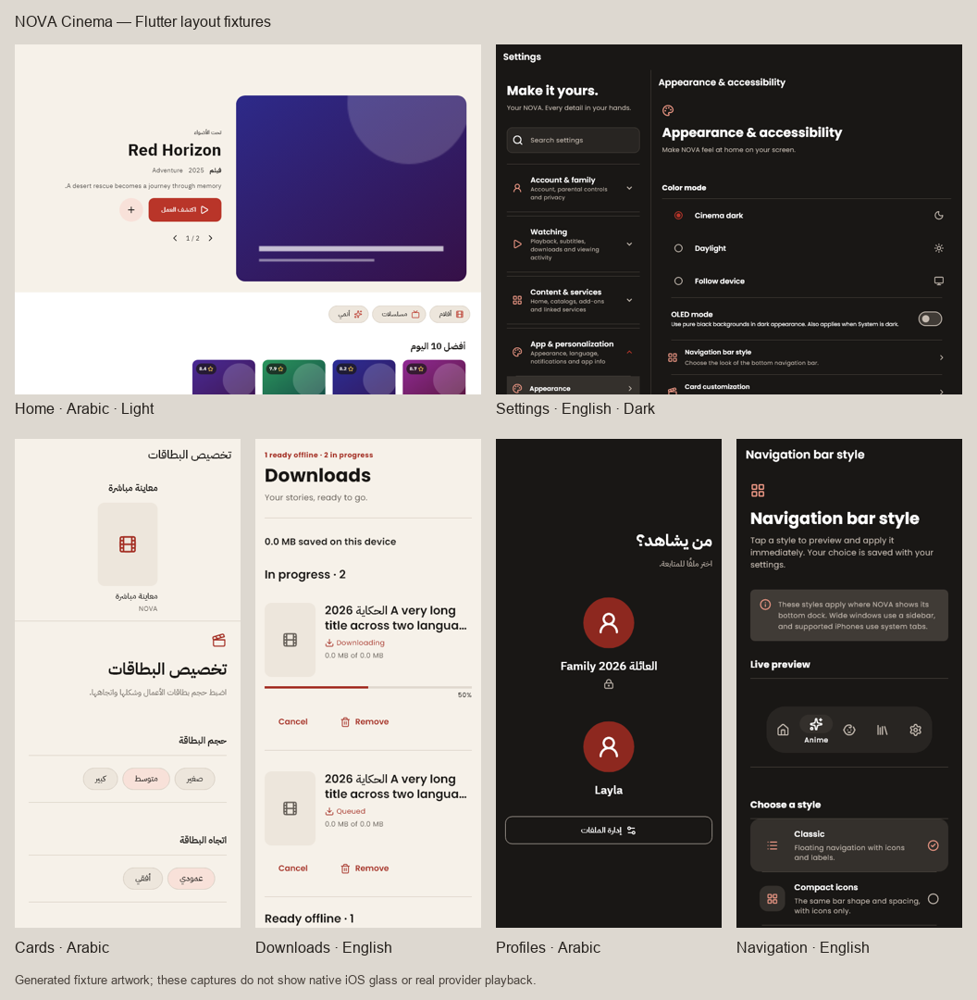

# NOVA Cinema redesign

User-authorized scope: every presentation surface, Android phones/tablets and
iPhone/iPad, English/Arabic, light/dark, loading/empty/error/interaction states.
Existing authentication, profile isolation, integrations, downloads, route IDs,
storage keys and Core/Legacy playback ownership remain functional contracts.

## Assignment ledger

| Task | Model | Reasoning | Assignment justification |
|---|---|---|---|
| Inventory and source audit | GPT-6.1 Sol | High | Broad route/state inventory and dependency tracing without mutations |
| Foundation and platform navigation | GPT-6.1 Terra | Ultra | Native materials, adaptive geometry, RTL and accessibility lifecycle have high integration risk |
| Personalization, settings, catalog | GPT-6 Sol | Max | Shared dimensions, persistence compatibility and provider URL handling cross many consumers |
| Account and secondary screen families | GPT-6.1 Sol | Max | Responsive recomposition must preserve authentication, grants, provider actions and bilingual flows |
| Hero, shared states, integration | Team lead | Ultra | Preview generations, visibility, resource retirement and final evidence require cross-system review |
| Detail and player presentation, added after foundation | GPT-6.1 Terra | Ultra | Adaptive panels must preserve playback ownership, commands and accessibility |
| Independent lifecycle review | GPT-6.1 Terra | Ultra | Verify asynchronous retirement, provider fallback and viewport gating independently |
| Cross-screen consistency review | GPT-6 Sol | Max | Trace shared image roles, actual navigation previews and preferences through consumers |
| Final responsive corrections | GPT-6.1 Sol | Max | Resolve inherited geometry, enlarged text, exact permissions and lazy native file-index selection |

GPT-6 Terra was unavailable; GPT-6.1 Terra is the available replacement.
The higher reasoning levels were retained for these final checks because they
cross shared geometry, accessibility and asynchronous lifecycle boundaries.

## Visual direction

A viewer browses artwork in a dim room, then returns to the same library in
daylight. Ink and warm-paper canvases each have their own readable hierarchy.
The NOVA logo remains recognizable; the surrounding product becomes an
artwork-led editorial interface with restrained vermilion actions. Text and
controls have their own calm surfaces. Glass is reserved for iOS navigation
and controls. Android uses Material 3 tonal surfaces and supported system color.

Phone navigation floats, remains reachable while scrolling, and reserves
content insets. Tablets use logical-start navigation, on the right in Arabic.
Compact multitasking windows adapt to their actual width. The UIKit overlay
does not own routes, data, parental authorization, or the player.

## Evidence and limits

The source inventory and problem ledger are in [audit.md](audit.md).
Implementation-specific notes are in [platform-foundation.md](platform-foundation.md),
[personalization.md](personalization.md), [screen-families.md](screen-families.md),
and [media-player.md](media-player.md). Final commands/results and remaining
acceptance work are in [qa.md](qa.md).

Flutter widget screenshots are evidence of Flutter layout only. Swift compilation,
native refraction, VoiceOver/TalkBack, actual trailer playback, network changes,
power restrictions, and device smoothness need their own build/device evidence.

